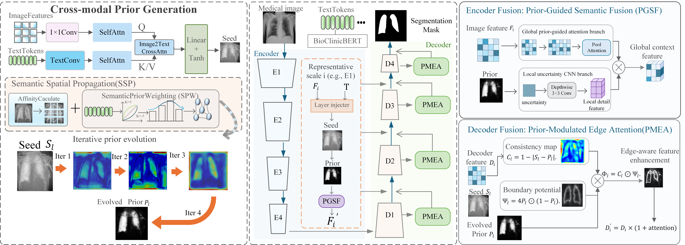
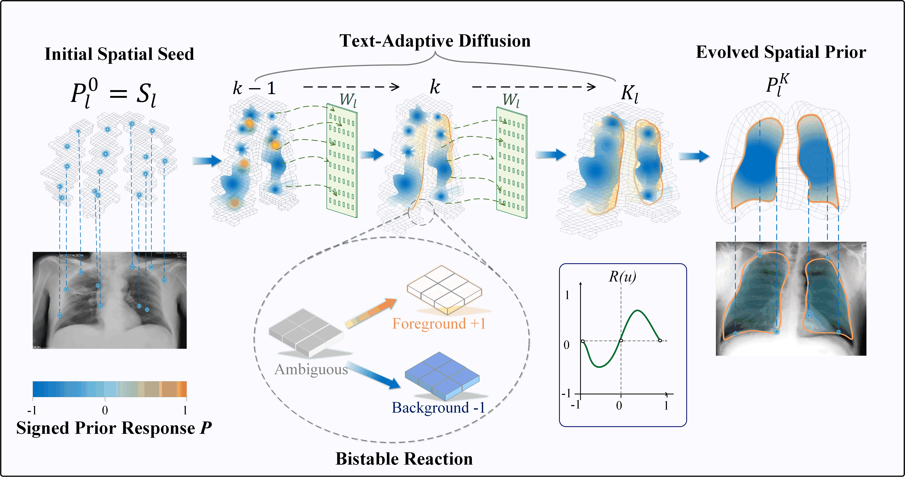

<!--
GitHub setup:
Place README.md in the repository root.
Place the three figures in the images folder:
images/image1.png
images/image2.png
images/image3.jpg
Keep these filenames unchanged, or update the relative links below.
-->

<div align="center">

# SPAN-Net

### Spatial Prior-Aware Network with Boundary Refinement<br>for Text-Guided Medical Image Segmentation

**From textual semantics to evolving spatial priors.**


<p>
  <a href="#overview"><b>Overview</b></a> ·
  <a href="#method"><b>Method</b></a> ·
  <a href="#results"><b>Results</b></a> ·
  <a href="#citation"><b>Citation</b></a>
</p>

</div>

## Overview

**SPAN-Net** converts image–text correspondence into explicit spatial priors and progressively refines them through text-guided reaction–diffusion propagation. These priors guide multi-scale feature fusion and boundary reconstruction throughout the encoder–decoder network.

- **Explicit spatial guidance:** transform textual cues into spatial seeds and evolve them using local visual affinities and text-adaptive gating.
- **Boundary-aware decoding:** reuse semantic seeds and evolved priors to refine target contours.
- **Strong benchmark performance:** highest BoundaryF1 on all four datasets; highest clDice on three and second-highest on BUSI.
- **Effective with fewer annotations:** highest Dice and JC among evaluated methods on all four datasets at 25%, 50%, and 75% training annotation ratios.

<p align="center">
  
</p>
<p align="center"><sub>Spatial priors connect text-guided localization, multi-scale fusion, and boundary refinement.</sub></p>

## Method

| Component | Role |
| :--- | :--- |
| **CPG** · Cross-Modal Prior Generator | Generates spatial seeds from image–text interactions and refines them through affinity-gated diffusion and bistable reaction. |
| **PGSF** · Prior-Guided Semantic Fusion | Combines prior-aware global aggregation with uncertainty-driven local enhancement. |
| **PMEA** · Prior-Modulated Edge Attention Decoder | Uses seed–prior consistency and boundary potential to refine decoder features. |

<p align="center">
  
</p>
<p align="center"><sub>Text-adaptive diffusion propagates spatial evidence; bistable reaction sharpens foreground–background separation.</sub></p>

## Motivation and Comparison

<p align="center">
  
</p>

Compact textual cues can provide limited spatial guidance when aligned with dense visual features. SPAN-Net makes this guidance explicit through spatial prior generation, evolution, and injection.

## Results

Full-training-set results reported in the manuscript. Dice, JC, BoundaryF1, and clDice are percentages; ↑ / ↓ indicate better performance.

| Dataset | Dice ↑ | JC ↑ | HD95 ↓ | BoundaryF1 ↑ | clDice ↑ |
| :--- | ---: | ---: | ---: | ---: | ---: |
| BKAI | 93.92 | 89.07 | 6.75 | **91.54** | 92.71 |
| BUSI | 83.21 | 75.43 | 21.04 | **58.02** | 87.28 |
| CVC-ClinicDB | 93.50 | 88.89 | 10.38 | **83.93** | 96.43 |
| QaTa-COV19 | 84.90 | 76.57 | 8.99 | **72.08** | 89.02 |

**BoundaryF1 ranks first on every dataset** among the 20 competing methods. On QaTa-COV19, SPAN-Net achieves **84.90% Dice** with **44.32M parameters** and **106.52G FLOPs**.

## Data & Training

We use the public image–text pairs provided by **MedCLIPSeg**, retaining the original descriptions. BKAI and CVC-ClinicDB cover endoscopic polyp segmentation, BUSI covers breast ultrasound, and QaTa-COV19 covers chest X-ray infection segmentation. The benchmark descriptions are template-generated rather than paired clinical reports.

| Setting | Configuration |
| :--- | :--- |
| Input resolution | 224 × 224 |
| Text encoder | Pretrained Bio_ClinicalBERT |
| Optimizer | Adam, initial learning rate 1 × 10⁻⁴, polynomial decay |
| Training | Batch size 4; up to 150 epochs; early stopping patience 50 |
| Supervision | Dice loss + cross-entropy loss + multi-scale geometric regression loss |
| Prior evolution steps | [8, 4, 2, 1], from shallow to deep encoder stages |

## Citation

If you find this work useful, please cite the manuscript:

```bibtex
@misc{wang_span_net,
  title  = {{SPAN-Net}: Spatial Prior-Aware Network with Boundary Refinement for Text-Guided Medical Image Segmentation},
  author = {Wang, Yuefei and Yang, Yang and Zhao, Jiayuan and Zhao, Binyu and Zhao, Liangyan and Tan, Haikun and An, Houlin and Zheng, Yuqing and Yu, Zhengyuan},
  note   = {Manuscript},
  url    = {https://github.com/YF-W/SPAN-Net}
}
```
